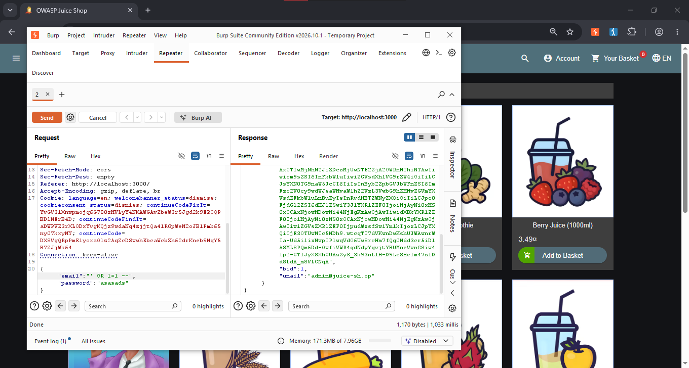
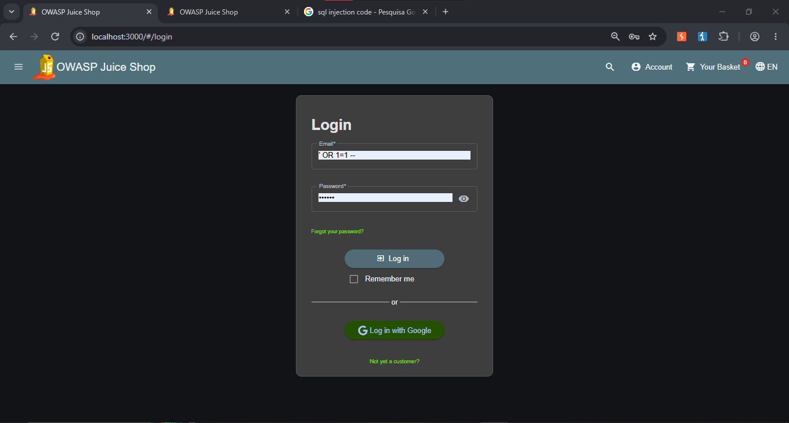
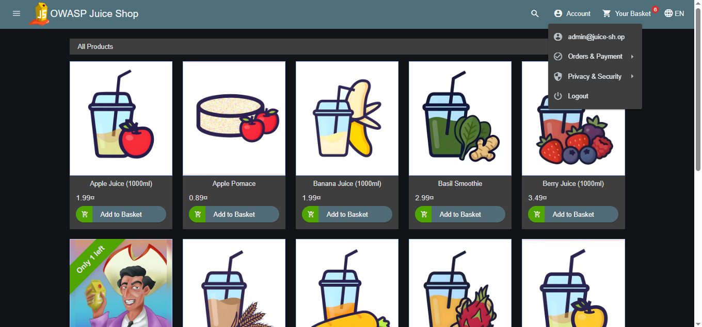
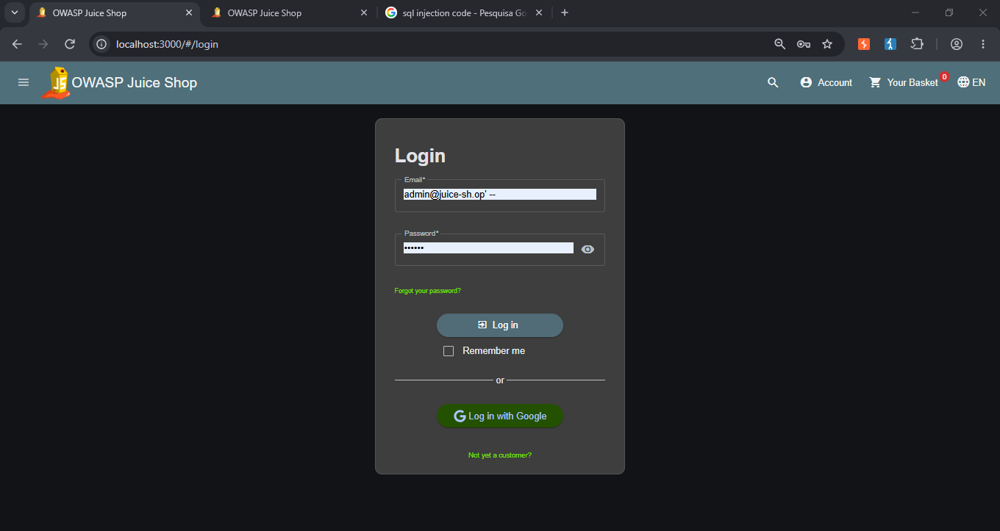
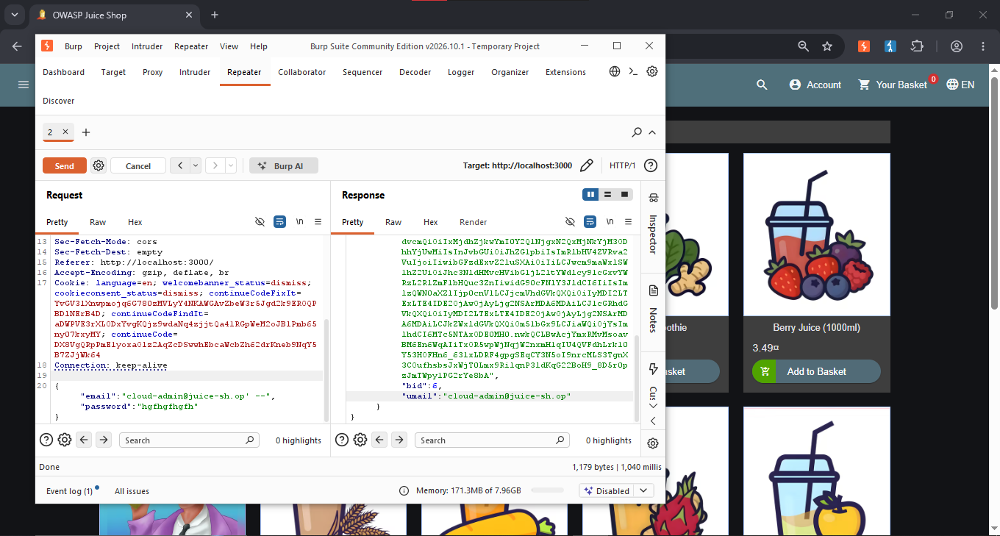
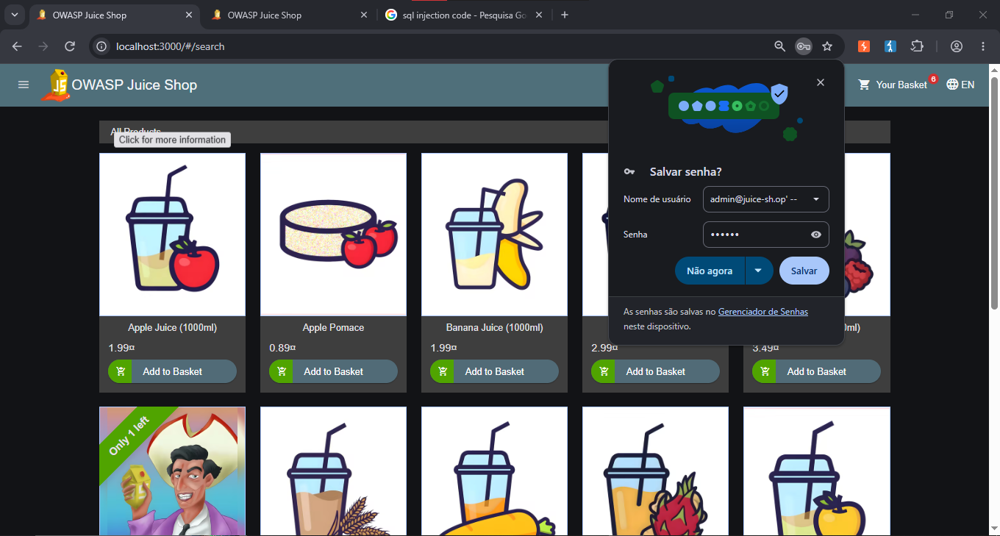

# Relatório Técnico de Prova de Conceito (PoC) — SQL Injection

**Projeto:** SACI — Trilha Red Team (Bloco 3)  
**Alvo:** OWASP Juice Shop (`http://localhost:3000`)  - Via Container Docker
**Vulnerabilidade:** SQL Injection - Bypass de Autentificação
**Endpoint Afetado:** `POST /rest/user/login`
**Severidade:** Crítica  
**Estudante:** Julio Cesar Crispim Silva 

---

## 1. Contextualização

Durante a análise de segurança na aplicação *OWASP Juice Shop*, foi identificada uma vulnerabilidade crítica de *SQL Injection* no mecanismo de autenticação (`POST /rest/user/login`).  A falha permite que um atacante manipule a estrutura da consulta SQL executada no banco de dados, contornando a verificação de senha e obtendo acesso autenticado à conta administrativa (`admin@juice-sh.op`) sem possuir suas credenciais.

---

## 2. Descrição Técnica da Falha

A vulnerabilidade ocorre devido à ausência de parametrização na construção das consultas SQL no backend. Em vez de tratar os dados recebidos na requisição HTTP como parâmetros literais, a aplicação concatena diretamente a entrada do usuário na string de comando SQL:

```javascript
// Exemplo da lógica vulnerável no backend
models.sequelize.query(
  `SELECT * FROM Users WHERE email = '${req.body.email || ''}' AND password = '${security.hash(req.body.password || '')}' AND deletedAt IS NULL`,
  { model: models.User, plain: true }
)
```
Essa concatenação faz com que ao escrever comandos em SQL no campo de autenticação do email, faz com que o invasor consiga se autenticar no sistema sem as devidas credenciais necessárias.

---

## 3. Códigos de Autenticação por SQLi

O seguinte código leva a autenticação como usuário administrador do sistema Juice Shop:

```sql
' OR 1=1 --
```
Isso acontece pois com ao colocar o caractere de aspa simples, ao concatenar o código o programa irá entender como um comando a ser executado ficando: 

```sql
SELECT * FROM Users WHERE email = '' OR 1=1 --
```
Os dois hifens são um comando para deixar o trecho seguinte do código comentado, ou seja, a necessidade de verificação da senha será descartada. Com isso, como a condição descrita no SQL "1=1" sempre será verdadeira, será autenticado o primeiro email do usuário da lista no Banco de Dados, que justamente se trata do administrador. 





Outra forma de conseguirmos adentrar a uma conta específica seja de usuários padrões ou de administradores, podemos utilizar esse outro comando:

```
[email do usuário]' --
```
Este segue a mesma lógica do anterior, o compilador irá interpretá-lo como um comando SQL e será possível adentrar em uma conta específica sem precisarmos da senha. Todos os emails dos usuários cadastrados no site podem ser vistos no endpoint `#/administration` com um usuário administrador.





---

## 4. Remediação Recomendada 

Para resolver o SQL Injection no login do Juice Shop, o objetivo principal é impedir que o banco de dados confunda o que é regra do sistema com o que é texto digitado pelo usuário:

```javascript
//Parameterized Query executada como Prepared Statement no SQLite
models.sequelize.query(
  'SELECT * FROM Users WHERE email = $1 AND password = $2 AND deletedAt IS NULL',
   { bind: [ req.body.email, security.hash(req.body.password) ], model: models.User, plain: true }
)
```

A correção divide o processo em duas etapas protegidas:

  - No código da aplicação (Parameterized Query): Em vez de colar o e-mail e a senha direto na frase SQL, é colocado os marcadores de posição $1 e $2 (placeholders). Nenhuma variável do usuário toca a string SQL;
  - No banco de dados (Prepared Statement): O banco recebe primeiro o esqueleto SELECT * FROM Users WHERE email = $1 AND password = $2 AND deletedAt IS NULL com os espaços vazios e entende a estrutura da busca. Só depois disso ele injeta os valores do array bind $1 e $2 para ler o que o usuário digitou nos parâmetros já compilados.

